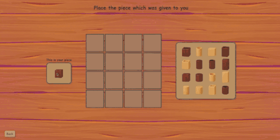
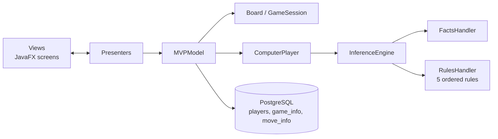

# Quarto: JavaFX game with a rule-based AI

A desktop version of the board game Quarto: you play against a rule-based computer opponent. Results are stored in PostgreSQL. The repo also contains the team's project website.



## Features

**Game (`game/`)**
- Full Quarto rules on a 4x4 board with 16 pieces (color, shape, height, fill). The game checks rows, columns and both diagonals for a win.
- Computer opponent driven by a small **inference engine**: facts are derived from the board ("AI can win now", "AI can reach three-in-a-line"). Ordered rules then pick the move, with a random move as fallback.
- Sign up / sign in, or **play as guest** without a database.
- Leaderboard (games, wins, win %, average moves, average move duration) computed in SQL.
- Results screen with a bar chart of move durations.
- Sound effects with per-category volume settings, and a help screen with the rules.

**Website (`website/`)**
- Static site with rules, team, project and install pages.
- Demo login and a stats page that reads sample game records from a JS file. Login is **client-side only and provides no real security**. All accounts and games in `website/db/` are fake.
- The website is informational only. It is not a playable web version of the game.

## Tech stack

Java 21, JavaFX 21, Maven, PostgreSQL (JDBC), JUnit 5, Docker Compose. Website: HTML, CSS, vanilla JavaScript (ES modules).

## Architecture

The game follows **Model-View-Presenter**. Each screen has a View (JavaFX layout only) and a Presenter (event handling), and they share one `MVPModel`. The model holds the board, game session, players, sound manager and database access. The AI is kept separate in `model/rulebasedsystem`.



## Getting started

Prerequisites: JDK 21, Maven 3.9+. Docker is optional and only needed for accounts and the leaderboard.

```bash
git clone https://github.com/miqqayell/quarto-javafx-game.git
cd quarto-javafx-game/game

# optional: start PostgreSQL with the schema preloaded
docker compose up -d

mvn javafx:run      # start the game
mvn test            # run the unit tests
```

Without a database, choose **Play as Guest**. Guest games are not saved, and the leaderboard shows a connection error.

Database settings are read from environment variables. The defaults match `docker-compose.yml`:

| Variable | Default |
|---|---|
| `QUARTO_DB_URL` | `jdbc:postgresql://localhost:5432/quarto` |
| `QUARTO_DB_USER` | `quarto` |
| `QUARTO_DB_PASSWORD` | `quarto` |
| `QUARTO_DB_PORT` (Docker host port) | `5432` |

See `game/.env.example`. The schema is in `game/db/schema.sql`.

To view the website, serve the folder over HTTP (ES modules don't load from `file://`):

```bash
cd website && python3 -m http.server 8000
# open http://localhost:8000/html/index.html  (demo login: demo_player / demo123)
```

## My role

Team lead in a team of four. I led the project, built the website, and designed and integrated the database.

## Team

| Member | Contribution |
|---|---|
| Mikayel Ghalumyan | Team lead, website, database design and integration |
| Teammate 1 | JavaFX interface and database operations in the game |
| Teammate 2 | Core gameplay mechanics and JavaFX UI elements |
| Teammate 3 | Server setup and deployment |

## Context

University project, KdG Applied Computer Science, ACS101 (Integration project, year 1), 2024-2025.

Quarto is a board game designed by Blaise Müller and published by Gigamic. This project is not affiliated with or endorsed by Gigamic.

The original database ran on the university network. When preparing this repository I added the Maven build, the reconstructed `schema.sql` with Docker Compose, the unit tests, and configuration through environment variables. The commit history shows each change.

## Possible improvements

- Hash passwords (e.g. BCrypt). They are currently stored in plain text.
- Use `PreparedStatement` parameters everywhere. Some lookups still build SQL by string concatenation.
- Implement the placeholder AI rules (blocking the player's winning move, "good move" heuristics).
- Move database calls off the JavaFX thread consistently, and remove leftover debug output.
